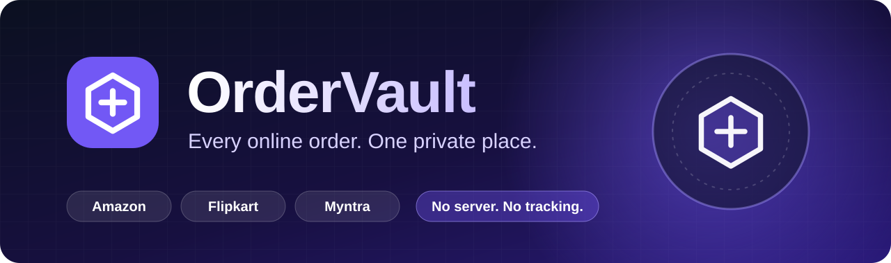
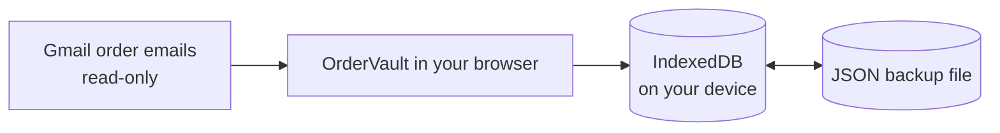

<div align="center">



<br>

**Stop digging through emails to find out where your parcel is.**
OrderVault gathers your Amazon, Flipkart and Myntra orders into one clean dashboard, and keeps all of it on **your** device.

<br>


[**Open the app**](https://vikashsahutech.github.io/OrderVault/) · [Get started](#get-started) · [How it works](#how-it-works) · [Privacy](#privacy-first-by-design) · [Limitations](#limitations) · [FAQ](#faq)

</div>

---

## Why OrderVault?

Your orders are scattered across inboxes, apps and "My Orders" pages. Finding a warranty, a return window or a delivery status means opening five tabs.

OrderVault pulls them together **without handing your data to anyone**.

| | |
| --- | --- |
| **One place** | Amazon, Flipkart and Myntra orders side by side. |
| **Private by design** | No account, no backend, no analytics. Everything lives in your browser. |
| **Read-only Gmail** | Finds your order emails and groups them by order ID. It cannot send, change or delete anything. |
| **Order details** | Open any order, correct what the parser got wrong, and keep your own notes. |
| **Warranty view** | See what you bought and what is still covered. |
| **Yours to keep** | Export everything to a JSON file. Import it on any device. |
| **Installable** | Works as a PWA on desktop and phone once hosted over HTTPS. |

---

## How it works



Gmail requests go straight from your browser to Google. Nothing in this diagram goes through a server of ours, because there isn't one.

---

## Get started

**You need:** Node.js 20.19+ or 22.12+, npm, and a Google account with Gmail.

```bash
npm install
npm run dev
```

Open **http://localhost:5173**, then open **Setup & privacy**, paste your own Google OAuth client ID and press **Save Client ID**. After that, press **Connect / sync Gmail**.

The ID is stored only in your browser, and it is not a secret. If you prefer a file, copy `.env.example` to `.env`, set `VITE_GOOGLE_CLIENT_ID` there and restart `npm run dev`. An ID saved in the app takes priority over `.env`.

<details>
<summary><b>Create your Google OAuth client ID (one-time, about 5 minutes)</b></summary>

1. Open the [Google Cloud Console](https://console.cloud.google.com/) and create a project, for example `OrderVault`.
2. **APIs & Services → Library**: enable **Gmail API**.
3. **Google Auth Platform → Branding**: set the app name, support email and developer contact email.
4. **Google Auth Platform → Audience**: choose **External** for a personal Gmail account. Keep it in **Testing** and add your own Gmail address under **Test users**.
5. **Google Auth Platform → Clients → Create client**, type **Web application**.
6. Under **Authorized JavaScript origins** add `http://localhost:5173`. If you host the app later, add its exact HTTPS origin too (the host only, with no path and no trailing slash).
7. Copy the **Client ID** and paste it into **Setup & privacy** in the app (or into `.env` as `VITE_GOOGLE_CLIENT_ID`). A browser app does not use a client secret, so never add one.

The app requests only `https://www.googleapis.com/auth/gmail.readonly`.

Useful docs: [Gmail API](https://developers.google.com/workspace/gmail/api) · [Google Identity Services](https://developers.google.com/identity/oauth2/web/guides/overview)
</details>

<details>
<summary><b>Build and install it as an app</b></summary>

```bash
npm run build
npm run preview
```

To install it as a PWA, deploy the `dist/` folder to a static host that serves **HTTPS**, and add that exact origin to the OAuth client's authorised origins. On desktop Chrome use the install icon in the address bar. On iPhone open the site in Safari, then Share, then Add to Home Screen. `localhost` only works for development on the same device.
</details>

---

## Your data

| What | Where it lives |
| --- | --- |
| Order records | IndexedDB database `ordervault-local`, store `orders` |
| Last-sync time | Browser localStorage |
| Your Google client ID | Browser localStorage (not a secret) |
| Gmail access token | Memory only. You re-authorise when needed. |
| Backup | **Export** gives a JSON file. **Import** restores it. |

- **Delete:** Setup & privacy, then Delete local orders. Clearing the browser's site data also removes everything.
- **Revoke Gmail access:** visit [myaccount.google.com/permissions](https://myaccount.google.com/permissions) and remove OrderVault.
- The app loads Google Identity Services and Google Fonts from Google's servers. Gmail requests go straight from your browser to Google. No OrderVault backend exists.

---

## Privacy first, by design

- **No server.** The app runs entirely on your device.
- **Read-only Gmail.** The app asks for `gmail.readonly` and nothing more.
- **Tokens stay in memory.** The Gmail access token is not written to storage.
- **Your own Google project.** You bring your own client ID, so nobody else's quota or consent screen is involved.

Browser extensions, malware, shared computer profiles and browser data loss are still risks to any data kept in a browser.

---

## Limitations

OrderVault is a working prototype, not a production marketplace integration. Please read these before connecting Gmail.

- Amazon, Flipkart and Myntra change their emails. The parser uses heuristics and will miss or misclassify some orders, so review the results.
- Emails do not reliably contain live courier events, refund confirmations or every historical order.
- Gmail search is capped at 1,500 matching messages per sync.
- Each browser keeps its own database. Use Export and Import to move data between devices.
- An email with no parseable order ID may show up as a separate order. A wrong ID can merge unrelated emails or split one order into several rows.
- Refunds and returns share one broad status. Bank credits are not reconciled.
- Product titles and amounts need a manual check.
- While your Google OAuth app is in Testing, Google shows an unverified-app warning. Public use of restricted Gmail scopes can require Google verification and a security assessment, so do not host this as a multi-user product without a proper security, privacy and OAuth review.

<details>
<summary><b>Troubleshooting</b></summary>

- **Error 400: origin_mismatch:** the address you opened the app from is not in the OAuth client's Authorized JavaScript origins. Add `http://localhost:5173` for local use, or the exact HTTPS host if hosted, and wait a few minutes.
- **Access blocked / app not verified:** make sure your account is listed as a test user while the app is in Testing.
- **Gmail API has not been used:** enable Gmail API in the same Cloud project as the OAuth client.
- **Google library did not load:** check your internet connection and reload.
- **No orders found:** search Gmail yourself for Amazon, Flipkart or Myntra order emails. The sender and subject search is deliberately conservative, so not every seller is recognised.
- **Orders missing on another device:** expected. Export on one device and import on the other.
</details>

---

## Project layout

```text
src/                     app, Gmail sync, parser, local database, components
public/vault.svg         app icon
index.html, vite.config.ts, package.json   Vite + React + TypeScript setup
.github/workflows/       deploys the app to GitHub Pages
assets/                  README images
```

---

## FAQ

<details>
<summary><b>Does my data ever leave my device?</b></summary>

Order records stay in your browser. Gmail requests go straight from your browser to Google. There is no OrderVault backend.
</details>

<details>
<summary><b>Will it find every order?</b></summary>

No. Shops change their emails, and the parser uses heuristics. Review what it finds. See [Limitations](#limitations).
</details>

<details>
<summary><b>Do my phone and PC stay in sync?</b></summary>

Not automatically. Each browser keeps its own copy. Export on one device and import on the other.
</details>

<details>
<summary><b>Is it ready for public hosting as a multi-user product?</b></summary>

No. It is a personal, local-first project. Public use of the Gmail scope would need Google's verification and a proper security review.
</details>

---

## Roadmap

- [ ] Marketplace-specific parsers with more sample fixtures
- [ ] A more accurate event timeline and tracking-number extraction
- [ ] Optional carrier tracking integrations
- [ ] Optional encrypted, user-controlled sync

A separate browser extension that reads order pages directly is planned as its own project.

---

## Contributing

Ideas and bug reports are welcome. If an order email is parsed wrongly, describe what the email looked like (with personal details removed) and what the app showed.

## Terms of use

Use OrderVault for your own account only. Each shop's terms still apply to how you use your own order data.

## Licence

Released under the [MIT Licence](LICENSE).

<div align="center">

<sub>Built for people who would rather keep their order history to themselves.</sub>

</div>
