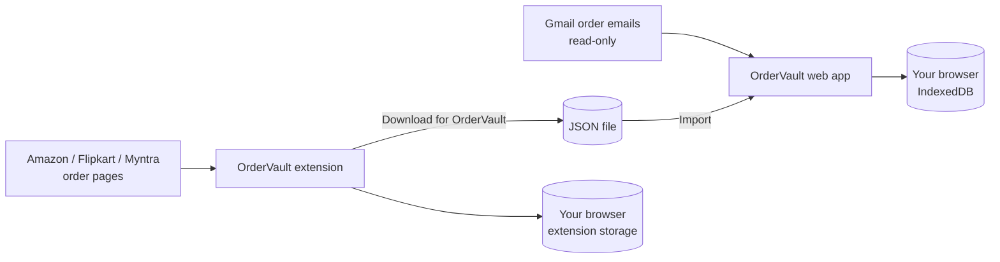

<div align="center">


<br>

**Stop digging through emails to find out where your parcel is.**
OrderVault gathers your Amazon, Flipkart and Myntra orders into one clean dashboard, and keeps all of it on **your** device.

<br>


[Get started](#get-started) · [How it works](#how-it-works) · [Privacy](#privacy-first-by-design) · [Limitations](#limitations) · [FAQ](#faq)

</div>

---

## Why OrderVault?

Your orders are scattered across inboxes, apps and "My Orders" pages. Finding a warranty, a return window or a delivery status means opening five tabs.

OrderVault pulls them together **without handing your data to anyone**.

| | |
| --- | --- |
| **One place** | Amazon, Flipkart and Myntra orders side by side. |
| **Private by design** | No account, no backend, no analytics. Everything lives in your browser. |
| **Two ways in** | Read order emails from Gmail (read-only), or read your order pages while you browse. |
| **Live status** | The extension keeps delivery status fresh and shows how many orders are still on the way. |
| **Warranty view** | See what you bought and what is still covered. |
| **Yours to keep** | Export everything to a JSON file. Import it on any device. |

---

## What is inside

This repository holds two parts that work together.

<table>
<tr>
<td width="50%" valign="top">

### Web app
[`ordervault-pwa/`](ordervault-pwa/)

An installable web app built with **React, TypeScript and Vite**.

- Connects to Gmail with **read-only** access
- Finds order emails and groups them by order ID
- Stores records in your browser (IndexedDB)
- Order details, manual editing, warranty view and sync log
- Works on desktop and phone once hosted over HTTPS

</td>
<td width="50%" valign="top">

### Browser extension
[`ordervault-extension/`](ordervault-extension/)

A **Chrome / Edge** extension for Amazon India, Flipkart and Myntra.

- Reads your order and tracking pages while you are signed in
- One button per shop, then the tab closes itself
- Badge shows orders still on the way
- Daily reminder if something is waiting to be refreshed
- Exports a file the web app can import

</td>
</tr>
</table>

---

## How it works



Nothing in this diagram goes through a server of ours, because there isn't one.

---

## Get started

### Web app

**You need:** Node.js 20.19+ or 22.12+, npm, and a Google account with Gmail.

```bash
cd ordervault-pwa
npm install
npm run dev
```

Open **http://localhost:5173**, then open **Setup & privacy**, paste your own Google OAuth client ID and press **Save Client ID**. After that, press **Connect / sync Gmail**.

The ID is stored only in your browser, and it is not a secret. If you prefer a file, copy `.env.example` to `.env`, set `VITE_GOOGLE_CLIENT_ID` there and restart `npm run dev`. An ID saved in the app takes priority over `.env`.

<details>
<summary><b>Create your Google OAuth client ID (one-time, about 5 minutes)</b></summary>

1. Open the [Google Cloud Console](https://console.cloud.google.com/) and create a project, for example `OrderVault`.
2. **APIs & Services → Library**: enable **Gmail API**.
3. **Google Auth Platform → Branding**: set the app name, support email and developer contact email.
4. **Google Auth Platform → Audience**: choose **External** for a personal Gmail account. Keep it in **Testing** and add your own Gmail address under **Test users**.
5. **Google Auth Platform → Clients → Create client**, type **Web application**.
6. Under **Authorized JavaScript origins** add `http://localhost:5173`. If you host the app later, add its exact HTTPS origin too.
7. Copy the **Client ID** and paste it into **Setup & privacy** in the app (or into `.env` as `VITE_GOOGLE_CLIENT_ID`). A browser app does not use a client secret, so never add one.

The app requests only `https://www.googleapis.com/auth/gmail.readonly`.

Useful docs: [Gmail API](https://developers.google.com/workspace/gmail/api) · [Google Identity Services](https://developers.google.com/identity/oauth2/web/guides/overview)
</details>

<details>
<summary><b>Build and install it as an app</b></summary>

```bash
npm run build
npm run preview
```

To install it as a PWA, deploy the `dist/` folder to a static host that serves **HTTPS**, and add that exact origin to the OAuth client's authorised origins. On desktop Chrome use the install icon in the address bar. On iPhone open the site in Safari, then Share, then Add to Home Screen. `localhost` only works for development on the same device.
</details>

### Browser extension

1. Open `chrome://extensions` (Edge: `edge://extensions`).
2. Turn on **Developer mode**.
3. Click **Load unpacked** and choose the [`ordervault-extension`](ordervault-extension/) folder.
4. Pin it, then press **Amazon orders**, **Flipkart orders** or **Myntra orders**. Stay signed in as normal, because the extension never sees your password.

<details>
<summary><b>What each button does</b></summary>

Each button opens that shop's orders page in a tab, reads it, saves it and **closes the tab again**.

- **Myntra** reads every page of the list, using up to three background tabs at once.
- **Flipkart** scrolls to the end of the list and presses **Show More Orders** until none are left. It runs in a visible tab, because Chrome pauses scrolling in tabs you cannot see.
- **Amazon** reads "past 3 months" and then every year the page offers, page after page, with up to three tabs on different years at once.
- If a shop shows a sign-in page, that one tab stays open and comes to the front so you can sign in. Press the button again afterwards.

You can also open an orders page or a "Track package" page yourself and wait a couple of seconds, or press **Read this page now**. The badge on the icon is the number of orders still on the way.
</details>

<details>
<summary><b>What the extension does and does not do</b></summary>

- It runs only when you press a shop button or open a shop's orders page yourself. It does not log in, submit forms or type anything.
- The one thing it presses is Flipkart's **Show More Orders** button, and only while you have asked it to read Flipkart.
- Everything is saved in `chrome.storage.local` on your device. It makes no network requests of its own.
- Permissions: `storage` (save orders), `scripting` (read the tab it opened), `alarms` and `notifications` (one daily reminder when orders are still on the way and not refreshed), plus access to the three shops' sites only.
- There is no background polling, so "live" means as live as the last time you looked.
- Status is whatever the shop's page says. Amazon's own courier has no public tracking, so nothing is looked up elsewhere.
</details>

### Bring them together

In the extension press **Download for OrderVault**, then choose **Import** in the web app and pick the file. Imported orders are marked "added by hand", so a Gmail sync never deletes them, and they use their own ids (`ext:...`). The same purchase can therefore appear twice, once from Gmail and once from the extension.

---

## Your data

| What | Where it lives |
| --- | --- |
| Order records (web app) | IndexedDB database `ordervault-local`, store `orders` |
| Last-sync time | Browser localStorage |
| Gmail access token | Memory only. You re-authorise when needed. |
| Order records (extension) | `chrome.storage.local` |
| Backup | **Export** gives a JSON file. **Import** restores it. |

- **Delete:** Setup & privacy, then Delete local orders. Clearing the browser's site data also removes everything.
- **Revoke Gmail access:** visit [myaccount.google.com/permissions](https://myaccount.google.com/permissions) and remove OrderVault.
- The web app loads Google Identity Services and Google Fonts from Google's servers. Gmail requests go straight from your browser to Google. No OrderVault backend exists.

---

## Privacy first, by design

- **No server.** Both parts run entirely on your device.
- **No passwords.** The extension reads pages you are already signed in to. It never sees your shop password.
- **Read-only Gmail.** The app asks for `gmail.readonly` and nothing more.
- **Tokens stay in memory.** The Gmail access token is not written to storage.
- **Invented test data.** The fixtures in this repository are synthetic. None of it comes from a real account.

Browser extensions, malware, shared computer profiles and browser data loss are still risks to any data kept in a browser.

---

## Limitations

OrderVault is a working prototype, not a production marketplace integration. Please read these before connecting Gmail.

- Amazon, Flipkart and Myntra change their emails and pages. The readers use heuristics and will miss or misclassify some orders, so review the results.
- Emails do not reliably contain live courier events, refund confirmations or every historical order.
- Gmail search is capped at 1,500 matching messages per sync.
- Each browser keeps its own database. Use Export and Import to move data between devices.
- An email with no parseable order ID may show up as a separate order. A wrong ID can merge unrelated emails or split one order into several rows.
- Refunds and returns share one broad status. Bank credits are not reconciled.
- Product titles and amounts need a manual check.
- While your Google OAuth app is in Testing, Google shows an unverified-app warning. Public use of restricted Gmail scopes can require Google verification and a security assessment, so do not host this as a multi-user product without a proper security, privacy and OAuth review.

<details>
<summary><b>Troubleshooting</b></summary>

- **Origin not allowed:** add `http://localhost:5173` to the OAuth client's Authorized JavaScript origins.
- **Access blocked / app not verified:** make sure your account is listed as a test user while the app is in Testing.
- **Gmail API has not been used:** enable Gmail API in the same Cloud project as the OAuth client.
- **Google library did not load:** check your internet connection and reload.
- **No orders found:** search Gmail yourself for Amazon, Flipkart or Myntra order emails. The sender and subject search is deliberately conservative, so not every seller is recognised.
- **Orders missing on another device:** expected. Export on one device and import on the other.
- **Extension says "A page was not recognised":** the shop changed its page. The popup shows an outline of the page structure (tags and class names only, none of your text). Sharing that outline is the fastest way to get the reader fixed.
</details>

---

## Project layout

```text
ordervault-pwa/          React + TypeScript + Vite web app
  src/                   app, Gmail sync, parser, local database, components
  public/vault.svg       app icon
ordervault-extension/    Chrome / Edge extension (Manifest V3)
  lib/                   shop readers (amazon, flipkart, myntra), merge, search, crawl
  content/reader.js      runs on the shop pages
  background.js          saves orders, badge, daily reminder
  popup/                 the popup window
  tests/                 tests and synthetic shop-page fixtures
assets/                  README images
```

---

## FAQ

<details>
<summary><b>Does my data ever leave my device?</b></summary>

Order records stay in your browser. Gmail requests go straight from your browser to Google. The extension makes no network requests of its own. There is no OrderVault backend.
</details>

<details>
<summary><b>Will it find every order?</b></summary>

No. Shops change their emails and pages, and the parser uses heuristics. Review what it finds. See [Limitations](#limitations).
</details>

<details>
<summary><b>Do my phone and PC stay in sync?</b></summary>

Not automatically. Each browser keeps its own copy. Export on one device and import on the other.
</details>

<details>
<summary><b>Is it ready for public hosting as a multi-user product?</b></summary>

No. It is a personal, local-first project. Public use of the Gmail scope would need Google's verification and a proper security review.
</details>

---

## Run the tests

The extension's readers are tested against **synthetic** pages in `ordervault-extension/tests/fixtures/` that imitate each shop's layout. They are not captures of real accounts, so passing them shows the logic works, not that the live sites match.

```bash
cd ordervault-extension
npm install
npm test
```

---

## Roadmap

- [ ] Marketplace-specific parsers with more sample fixtures
- [ ] A more accurate event timeline and tracking-number extraction
- [ ] Optional carrier tracking integrations
- [ ] Optional encrypted, user-controlled sync

---

## Contributing

Ideas and bug reports are welcome. If a shop page is not recognised, the extension shows an outline of the page structure (tags and class names only, none of your text). Sharing that outline is the fastest way to get it fixed.

## Terms of use

Use OrderVault for your own account only. Reading your own orders from pages you opened yourself is not scraping at scale, but each shop's terms still apply to automated tools.

## Licence

Released under the [MIT Licence](LICENSE).

<div align="center">

<sub>Built for people who would rather keep their order history to themselves.</sub>

</div>
